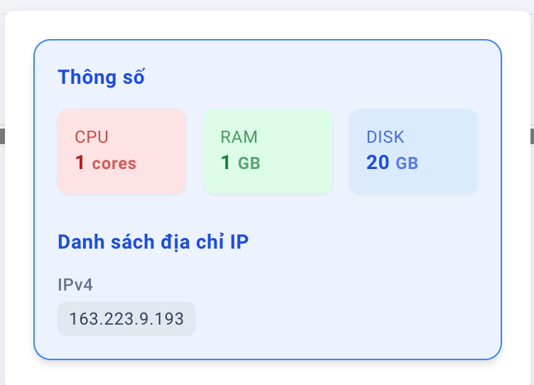
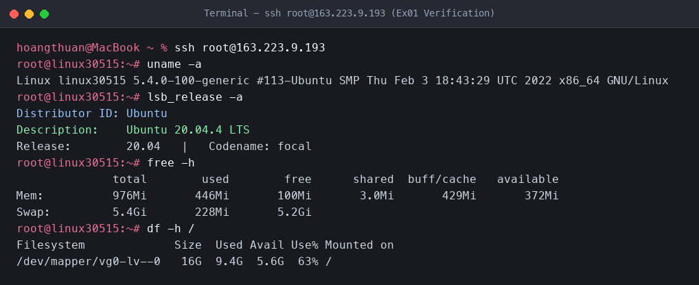

# Bài tập 1 (SS11): Khởi tạo và kết nối VPS

## 1. Thông tin máy chủ VPS

* **Địa chỉ IP Public:** `163.223.9.193`
* **Hostname:** `linux30515`
* **Cấu hình Cloud:** `1 CPU core`, `1 GB RAM`, `20 GB Disk`
* **Hệ điều hành:** `Ubuntu 20.04.4 LTS` (`focal`)
* **Kernel:** `Linux 5.4.0-100-generic #113-Ubuntu SMP x86_64`

---

## 2. Lệnh kết nối SSH từ máy cá nhân (macOS)

```bash
# Kết nối SSH vào VPS bằng địa chỉ IP Public
ssh root@163.223.9.193

# Kiểm tra thông số hệ điều hành & tài nguyên trên VPS
uname -a
lsb_release -a
free -h
df -h /
```

---

## 3. Ảnh minh chứng kết quả

### a. Ảnh cấu hình thông số VPS trên giao diện Cloud (`vps_cloud_specs.png`)


### b. Ảnh Terminal đăng nhập thành công và kiểm tra thông số hệ thống (`ex01_ssh_login.png`)

