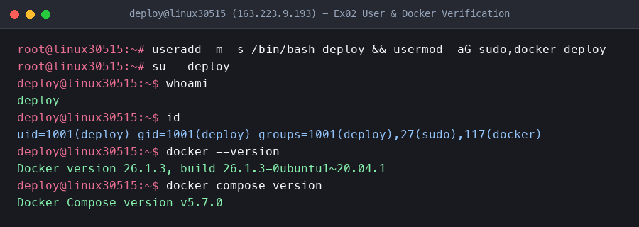

# Bài tập 2 (SS11): Tạo User Deploy và Cài đặt Docker

## 1. File lệnh & Script tự động hóa
- Danh sách lệnh Linux đã thực thi: [`commands.txt`](./commands.txt)
- Script cài đặt tự động: [`setup-deploy-docker.sh`](./setup-deploy-docker.sh)

---

## 2. Chi tiết các bước đã thực thi trên VPS

```bash
# 1. Tạo user 'deploy' với thư mục home và shell /bin/bash
useradd -m -s /bin/bash deploy

# 2. Cấp quyền sudo và thêm vào nhóm docker
usermod -aG sudo,docker deploy
echo "deploy ALL=(ALL) NOPASSWD:ALL" > /etc/sudoers.d/deploy
chmod 440 /etc/sudoers.d/deploy

# 3. Kiểm tra chạy lệnh docker dưới quyền user 'deploy'
su - deploy -c "whoami && id && docker --version && docker compose version"
```

---

## 3. Kết quả kiểm thử thực tế trên VPS (`ex02_deploy_docker.png`)

```text
deploy
uid=1001(deploy) gid=1001(deploy) groups=1001(deploy),27(sudo),117(docker)
Docker version 26.1.3, build 26.1.3-0ubuntu1~20.04.1
Docker Compose version v5.7.0
```


