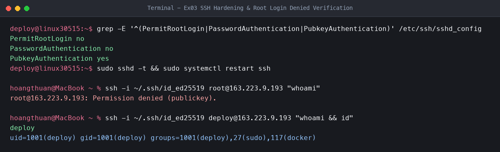

# Bài tập 3 (SS11): Tăng cường bảo mật SSH

## 1. File lệnh & Script thực thi
- Danh sách lệnh SSH Key & Hardening: [`commands.txt`](./commands.txt)
- Script tự động cấu hình SSH: [`harden-ssh.sh`](./harden-ssh.sh)

---

## 2. Quy trình đã thực hiện trên VPS `163.223.9.193`

1. **Cài đặt Public Key (`~/.ssh/id_ed25519.pub`) vào `/home/deploy/.ssh/authorized_keys`:**
   ```bash
   mkdir -p /home/deploy/.ssh
   # Ghi public key vào authorized_keys
   chmod 700 /home/deploy/.ssh
   chmod 600 /home/deploy/.ssh/authorized_keys
   chown -R deploy:deploy /home/deploy/.ssh
   ```
2. **Kiểm tra đăng nhập thành công bằng SSH Key với user `deploy` TRƯỚC khi tắt root/password:**
   ```bash
   ssh -i ~/.ssh/id_ed25519 deploy@163.223.9.193 "whoami && sudo whoami"
   # Output: deploy / root
   ```
3. **Cấu hình `/etc/ssh/sshd_config` và khởi động lại SSH:**
   ```bash
   sudo sed -i -E 's/^#?PermitRootLogin.*/PermitRootLogin no/' /etc/ssh/sshd_config
   sudo sed -i -E 's/^#?PasswordAuthentication.*/PasswordAuthentication no/' /etc/ssh/sshd_config
   sudo sed -i -E 's/^#?PubkeyAuthentication.*/PubkeyAuthentication yes/' /etc/ssh/sshd_config
   sudo sshd -t && sudo systemctl restart ssh
   ```

---

## 3. Kết quả kiểm thử thực tế (`ex03_ssh_hardening.png`)

* **Đăng nhập bằng `root` bị từ chối hoàn toàn:**
  ```text
  root@163.223.9.193: Permission denied (publickey).
  ```
* **Đăng nhập bằng `deploy` qua SSH Key thành công:**
  ```text
  deploy
  uid=1001(deploy) gid=1001(deploy) groups=1001(deploy),27(sudo),117(docker)
  ```


