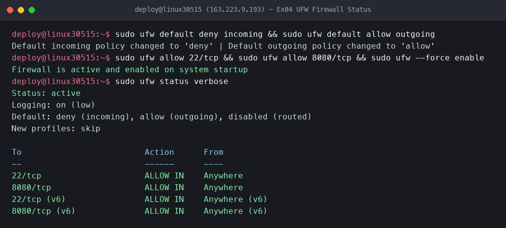
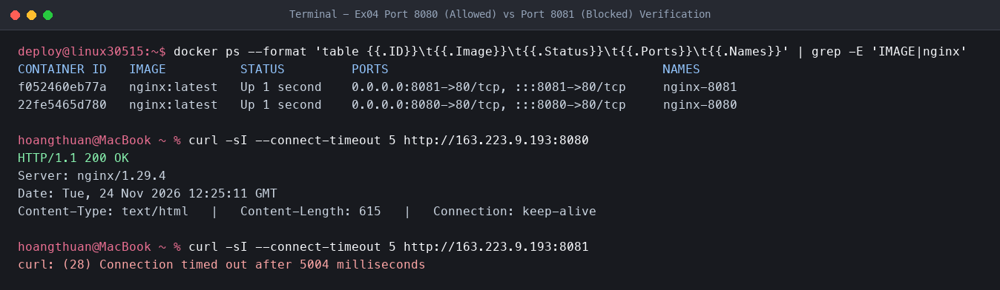

# Bài tập 4 (SS11): Cấu hình Firewall UFW

## 1. Script cấu hình Firewall UFW
- Script thực thi: [`setup-ufw.sh`](./setup-ufw.sh)

---

## 2. Các lệnh đã thực thi trên VPS `163.223.9.193`

```bash
# 1. Đặt chính sách mặc định: chặn tất cả kết nối đến, cho phép đi ra
sudo ufw default deny incoming
sudo ufw default allow outgoing

# 2. Mở cổng SSH (22/tcp) TRƯỚC khi bật UFW và mở cổng 8080/tcp
sudo ufw allow 22/tcp
sudo ufw allow 8080/tcp

# 3. Bật UFW và kiểm tra trạng thái chi tiết
sudo ufw --force enable
sudo ufw status verbose

# 4. Chạy 2 container Nginx trên cổng 8080 (được phép) và 8081 (bị chặn)
docker run -d --name nginx-8080 -p 8080:80 nginx:latest
docker run -d --name nginx-8081 -p 8081:80 nginx:latest
```

---

## 3. Kết quả kiểm thử thực tế

### a. Trạng thái tường lửa (`sudo ufw status verbose`) (`ex04_ufw_status.png`)
```text
Status: active
Logging: on (low)
Default: deny (incoming), allow (outgoing), disabled (routed)
New profiles: skip

To                         Action      From
--                         ------      ----
22/tcp                     ALLOW IN    Anywhere
8080/tcp                   ALLOW IN    Anywhere
22/tcp (v6)                ALLOW IN    Anywhere (v6)
8080/tcp (v6)              ALLOW IN    Anywhere (v6)
```



### b. So sánh truy cập từ bên ngoài vào cổng `8080` và `8081` (`ex04_port_8080_vs_8081.png`)
* **Cổng `8080` (đã mở trên UFW):**
  ```text
  HTTP/1.1 200 OK
  Server: nginx/1.29.4
  ```
* **Cổng `8081` (không mở trên UFW $\rightarrow$ bị chặn):**
  ```text
  curl: (28) Connection timed out after 5004 milliseconds
  ```


